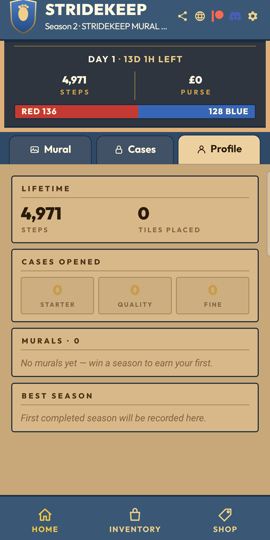
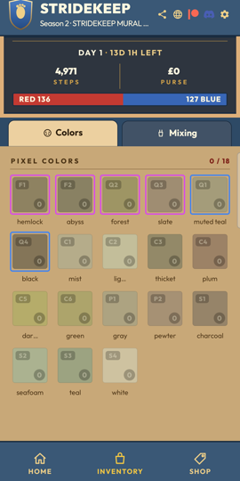
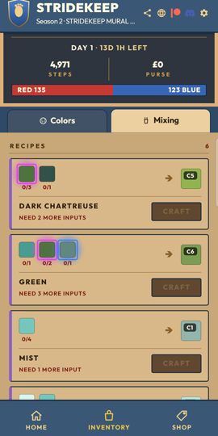

# Stridekeep (legacy)

> Real walking. Shared murals. Team victories earned, not bought.

  

A team-based idle walking game for Android. Your real step count is the only resource. Players join Team Red or Team Blue, walking unlocks cases of colored tiles, and each team races to paint the season's pixel-art mural, paint-by-numbers style. The winning team keeps the finished mural as a badge. The game is free, with no microtransactions and no loot-box gambling.

This repository is the archived React Native version. The Stridekeep name has since moved to a different project.

## Tech

- **App:** React Native, Expo, TypeScript, Zustand, React Navigation
- **Steps:** Android Health Connect, with two custom Expo config plugins for the permission flow and the Android 14 rationale screen
- **Backend:** Supabase: Postgres with row-level security, atomic RPCs for tile placement and season rollover, realtime team progress, and anonymous accounts that can be upgraded to email
- **Live world:** live activity feed, a trading-style team chart, milestone celebrations and an end-of-season ceremony
- **Tooling:** a standalone Godot tool that turns a mural image into a per-season palette and uploads it, plus a bot runner for load testing

## Run

```bash
npm install
npx expo run:android
```

Health Connect needs a native build; it does not run in Expo Go. Supabase settings live in `app.json` under `extra`.
